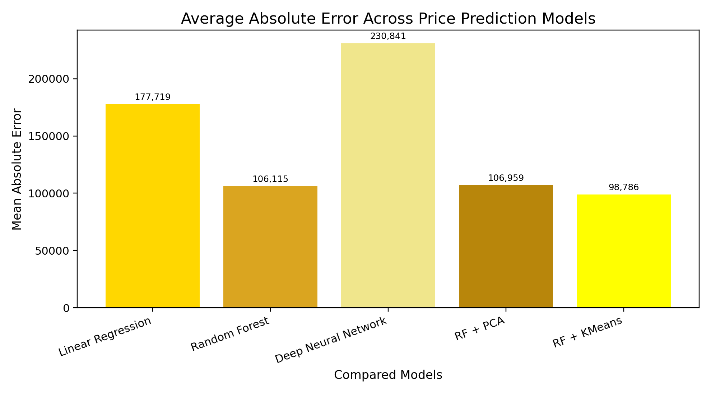
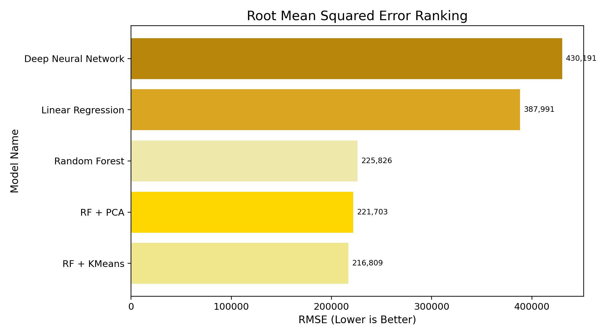
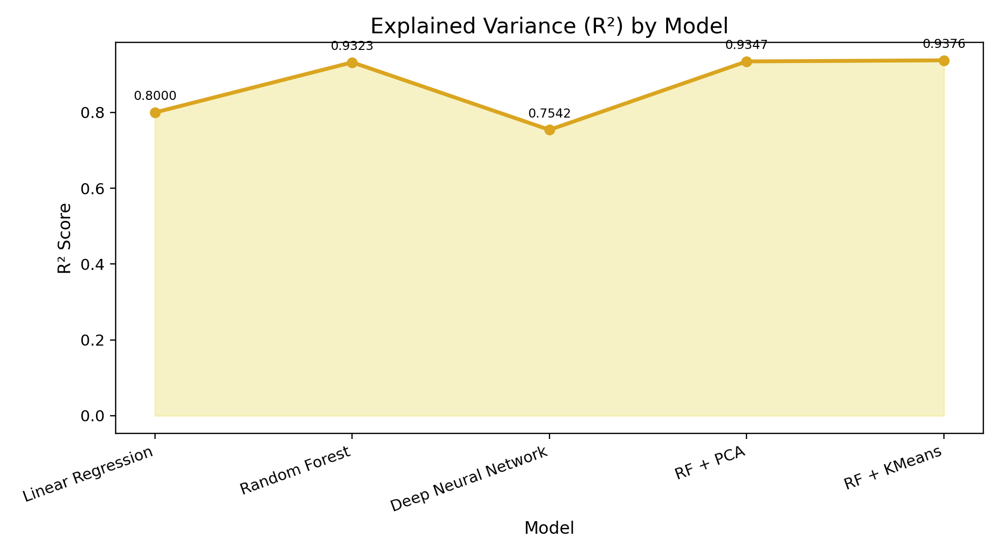
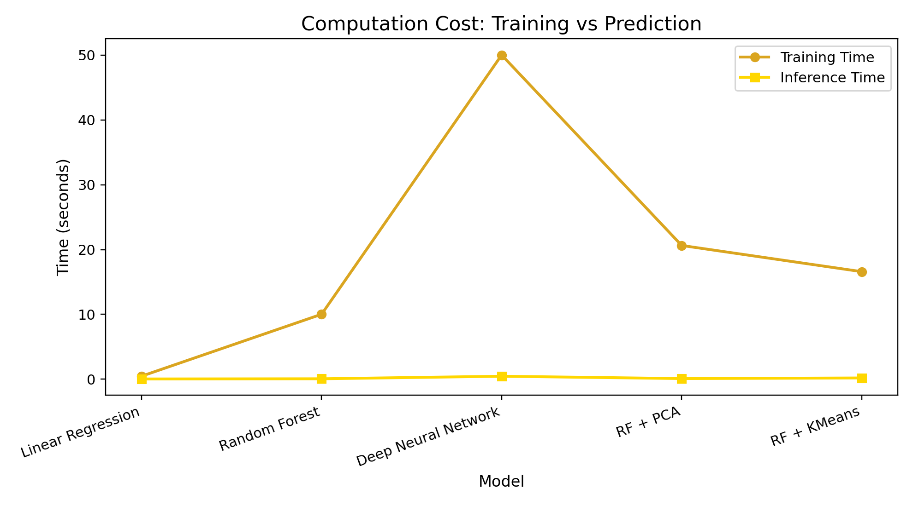
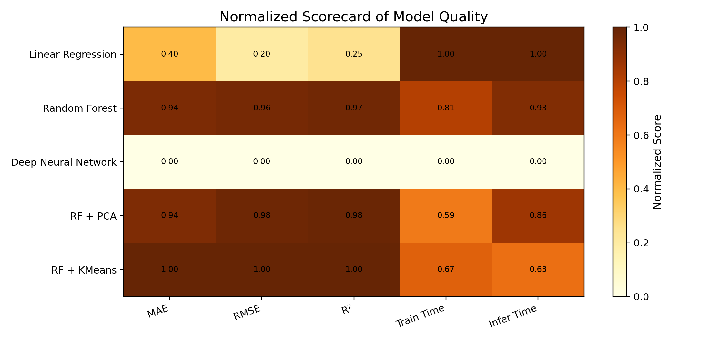
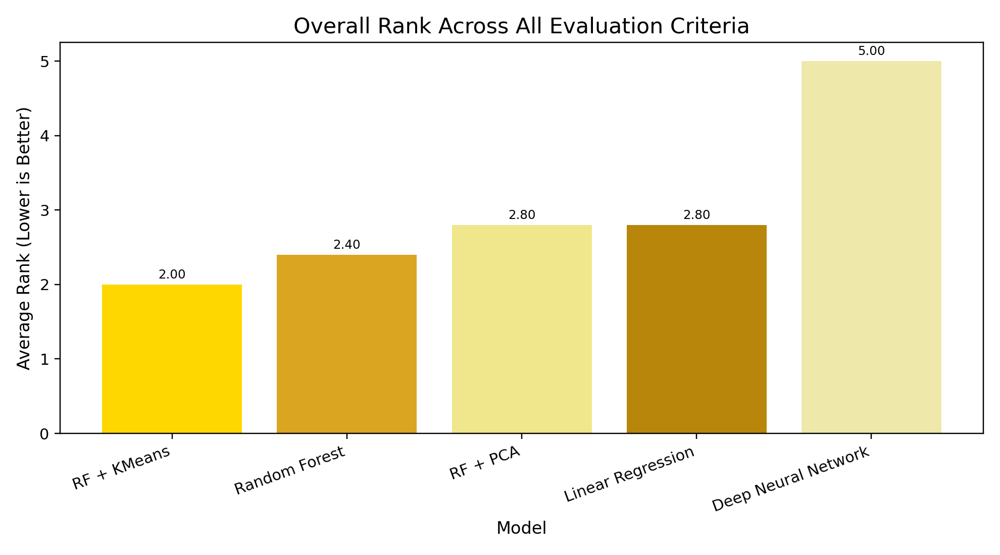

# 🚗 Explainable Used-Car Price Prediction

A machine-learning project for predicting **used-car selling prices** from structured CarDekho vehicle data.  
The project compares classical regression, ensemble learning, deep learning, and two hybrid feature-augmentation approaches.

> **Project status:** Training and evaluation results are included in `results/`, together with the full reproducible notebook and source code.

---

## Project Overview

Used-car valuation is a nonlinear regression problem. A vehicle's selling price depends on several interacting factors such as:

- vehicle age
- kilometres driven
- mileage
- engine capacity
- maximum power
- seating capacity
- brand and model
- fuel type
- transmission type
- seller type

A single linear relationship is unlikely to capture all of these interactions. This project therefore compares multiple modelling strategies under a shared preprocessing pipeline.

### Models compared

1. **Linear Regression** — interpretable baseline
2. **Random Forest Regressor** — nonlinear tree ensemble
3. **Deep Neural Network** — two hidden-layer feed-forward model
4. **Random Forest + PCA** — Random Forest with five principal components appended as additional features
5. **Random Forest + K-Means** — Random Forest with a three-cluster latent segment feature

---

## Repository Structure

```text
used-car-price-ml/
├── README.md
├── requirements.txt
├── .gitignore
├── data/
│   └── cardekho_dataset.csv
├── notebooks/
│   └── used_car_price_prediction.ipynb
├── src/
│   ├── __init__.py
│   ├── analysis_utils.py
│   └── generate_figures.py
└── results/
    ├── model_results.csv
    └── figures/
        ├── mae_comparison.png
        ├── rmse_comparison.png
        ├── r2_comparison.png
        ├── training_time_comparison.png
        ├── inference_time_comparison.png
        ├── mae_ranking.png
        ├── rmse_ranking.png
        ├── r2_ranking.png
        ├── mae_rmse_comparison.png
        ├── efficiency_comparison.png
        ├── training_vs_r2_scatter.png
        ├── mae_vs_training_scatter.png
        ├── normalized_performance_heatmap.png
        └── overall_model_ranking.png
```

---

## Dataset

The project uses a structured **CarDekho used-car dataset** containing vehicle specifications and listing information.

### Main input features

| Feature | Type | Meaning |
|---|---|---|
| `vehicle_age` | Numerical | Vehicle age in years |
| `km_driven` | Numerical | Total distance driven |
| `mileage` | Numerical | Fuel-efficiency measure |
| `engine` | Numerical | Engine capacity |
| `max_power` | Numerical | Maximum engine power |
| `seats` | Numerical | Number of seats |
| `brand` | Categorical | Vehicle manufacturer |
| `model` | Categorical | Vehicle model |
| `seller_type` | Categorical | Dealer / individual / other |
| `fuel_type` | Categorical | Petrol / diesel / other |
| `transmission_type` | Categorical | Manual / automatic |

### Target

```text
selling_price
```

The goal is to learn a regression function:

```text
vehicle characteristics  →  estimated selling price
```

---

## Machine-Learning Pipeline

```text
CarDekho dataset
        │
        ▼
Data cleaning
        │
        ├── remove duplicates
        ├── remove exported index column
        └── inspect missing values
        │
        ▼
Train/Test Split (80/20)
        │
        ▼
Shared preprocessing
        │
        ├── StandardScaler for numerical features
        └── OneHotEncoder for categorical features
        │
        ├─────────────────────────────────────────────┐
        ▼                                             ▼
Linear Regression                             Random Forest
                                                      │
                         ┌────────────────────────────┼───────────────────────┐
                         ▼                            ▼                       ▼
                       DNN                       RF + PCA               RF + K-Means
                         │                            │                       │
                         └────────────────────────────┴───────────────────────┘
                                                      │
                                                      ▼
                                           MAE / RMSE / R²
                                                      │
                                                      ▼
                                      Training & inference timing
                                                      │
                                                      ▼
                                          Feature importance
```

---

## Preprocessing

### Numerical features

Numerical attributes are standardized using:

```python
StandardScaler()
```

Standardization is particularly useful for Linear Regression, PCA, K-Means, and neural-network optimization.

### Categorical features

Categorical variables are encoded using:

```python
OneHotEncoder(
    drop="first",
    handle_unknown="ignore"
)
```

`handle_unknown="ignore"` allows the preprocessing pipeline to safely transform categories that were not present during fitting.

### Shared transformation

The transformations are composed with scikit-learn's `ColumnTransformer`, keeping numerical and categorical processing in one reusable pipeline.

---

## Models

### 1. Linear Regression

Linear Regression acts as the baseline model.

It is computationally inexpensive and easy to interpret, but it assumes a linear relationship between predictors and the target. Used-car pricing contains strong nonlinear effects, so the baseline establishes how much improvement more flexible methods provide.

---

### 2. Random Forest Regressor

The Random Forest model uses multiple decision trees and averages their predictions.

Configuration used in the reproducible notebook:

```python
RandomForestRegressor(
    n_estimators=100,
    max_depth=10,
    random_state=42
)
```

Random Forest is well suited to structured tabular data because it can capture:

- nonlinear relationships
- interactions between variables
- threshold effects
- heterogeneous feature behaviour

---

### 3. Deep Neural Network

The neural network contains two hidden layers:

```text
Input
  ↓
Dense(64, ReLU)
  ↓
Dense(32, ReLU)
  ↓
Dense(1)
```

Training configuration:

- optimizer: Adam
- loss: Mean Squared Error
- epochs: 50
- internal validation split

This experiment is useful because it tests whether additional model complexity improves prediction on structured tabular data.

---

### 4. Random Forest + PCA

Principal Component Analysis is applied to the encoded feature space.

```python
PCA(n_components=5)
```

The five principal components are **appended** to the existing processed features rather than replacing them. This tests whether compressed latent variance patterns provide additional predictive information.

---

### 5. Random Forest + K-Means

K-Means clustering identifies latent groups in the processed vehicle data:

```python
KMeans(
    n_clusters=3,
    random_state=42
)
```

The cluster ID is added as one more predictor before fitting Random Forest.

Conceptually:

```text
normal vehicle features
        +
discovered cluster label
        ↓
Random Forest
```

This hybrid approach allows an unsupervised algorithm to discover hidden segmentation that can then be used by the supervised regression model.

---

## Evaluation Metrics

The models are compared using five measures.

### Mean Absolute Error (MAE)

Average absolute difference between actual and predicted price.

```text
lower is better
```

### Root Mean Squared Error (RMSE)

Similar to MAE, but larger errors are penalized more strongly.

```text
lower is better
```

### R² Score

Measures how much of the variance in selling price is explained by the model.

```text
closer to 1 is better
```

### Training Time

Time needed to fit the model.

### Inference Time

Time required to produce predictions for the test set.

---

## Experimental Results

The completed experiment produced:

| Model | MAE | RMSE | R² | Train Time (s) | Inference Time (s) |
|---|---:|---:|---:|---:|---:|
| Linear Regression | 177,718.78 | 387,990.71 | 0.8000 | 0.470 | 0.040 |
| Random Forest | 106,114.77 | 225,825.89 | 0.9323 | 10.022 | 0.069 |
| Deep Neural Network | 230,841.13 | 430,190.80 | 0.7542 | 50.008 | 0.461 |
| RF + PCA | 106,958.72 | 221,702.61 | 0.9347 | 20.628 | 0.099 |
| **RF + K-Means** | **98,786.00** | **216,808.63** | **0.9376** | **16.589** | **0.198** |

### Main finding

**Random Forest + K-Means produced the strongest predictive results in this experiment.**

Compared with the standard Random Forest, the hybrid model achieved:

- lower MAE
- lower RMSE
- higher R²

This suggests that the latent cluster feature captured information useful to the price-regression task.

---

## Results Visualizations

The repository includes a newly restyled set of summary visualizations generated directly from `results/model_results.csv`, with updated chart wording, layouts, and colors.

### MAE Comparison



### RMSE Comparison



### R² Comparison



### Efficiency Comparison



### Normalized Performance Heatmap



### Overall Model Ranking



Additional figures in the `results/figures/` folder show metric rankings and trade-off views derived from the same result table.

## Why the DNN Did Not Win

A deeper model is not automatically a better model.

For this structured tabular dataset:

- the dataset is relatively modest in size
- most information is contained in conventional numerical/categorical columns
- tree ensembles naturally capture nonlinear thresholds and feature interactions
- DNN training introduces additional optimization complexity and computational cost

The experiment therefore demonstrates why model selection should be empirical rather than based solely on model complexity.

---

## How to Run

### 1. Clone the repository

```bash
git clone <YOUR-REPOSITORY-URL>
cd used-car-price-ml
```

### 2. Create a virtual environment

Windows:

```bash
python -m venv .venv
.venv\Scripts\activate
```

macOS/Linux:

```bash
python3 -m venv .venv
source .venv/bin/activate
```

### 3. Install dependencies

```bash
pip install -r requirements.txt
```

### 4. Open the notebook

```bash
jupyter notebook notebooks/used_car_price_prediction.ipynb
```

The trained result CSV and figures can be inspected immediately. The notebook also contains the full model-training workflow for reproducibility.

---


## Regenerate the Result Figures

The 14 summary figures are generated directly from `results/model_results.csv`.

```bash
python src/generate_figures.py
```

This recreates the yellow/gold charts in `results/figures/`.

> Exact training times and small metric differences can vary across Python/library versions and hardware when models are retrained.

---

## Running in Google Colab

1. Upload `used_car_price_prediction.ipynb`
2. Upload `cardekho_dataset.csv`
3. Update `DATA_PATH` if required
4. Run the preprocessing cells
5. Run only the model sections you want to reproduce

A GPU is not required for the classical ML models. TensorFlow can also run on CPU for this dataset.

---

## Key ML Concepts Demonstrated

This project demonstrates practical use of:

- supervised regression
- ensemble learning
- deep neural networks
- unsupervised clustering
- dimensionality reduction
- feature augmentation
- one-hot encoding
- feature scaling
- reproducible train/test splitting
- regression evaluation
- computational-efficiency comparison
- global feature importance

---

## Limitations

The project has several limitations:

1. **Single market dataset**  
   The data primarily represents used-car listings from one market, so performance may differ in other countries.

2. **Rare categories**  
   Brands or models with limited training examples can be harder to predict accurately.

3. **Vehicle condition**  
   Important real-world factors such as accident history, service history, body condition, and exact geographic location are not fully represented.

4. **Point predictions only**  
   The model returns a price estimate but not a confidence or prediction interval.

5. **Global feature importance**  
   Random Forest importance identifies generally influential features but does not fully explain an individual prediction.

---

## Future Improvements

Possible extensions include:

- SHAP-based local explanations
- XGBoost / LightGBM / CatBoost comparison
- cross-validation
- systematic hyperparameter tuning
- prediction intervals
- model serialization
- REST API deployment
- Streamlit/Flask user interface
- evaluation on an international used-car dataset

---

## Interview-Friendly Explanation

A concise explanation of the project:

> I worked with structured CarDekho used-car data to compare several regression approaches under the same preprocessing pipeline. Numerical variables were standardized and categorical variables were one-hot encoded. I compared Linear Regression, Random Forest and a small neural network, then tested PCA and K-Means as unsupervised feature-augmentation techniques. Random Forest with a K-Means cluster feature achieved the best stored result, with an R² of approximately 0.938 and the lowest MAE/RMSE among the compared models.

### Questions to be ready for

**Why Random Forest?**  
It models nonlinear relationships and feature interactions effectively on tabular data.

**Why use MAE and RMSE together?**  
MAE gives an intuitive average error, while RMSE penalizes large errors more heavily.

**Why one-hot encoding?**  
Most ML algorithms require numerical input, and one-hot encoding represents categories without imposing an artificial numeric order.

**What does R² = 0.9376 mean?**  
Approximately 93.76% of the variance in the test-set selling prices was explained by the fitted model in that experiment.

**Why add K-Means?**  
The cluster label provides a compact representation of latent vehicle segments that Random Forest can use as an additional predictor.

**Why did the DNN perform worse?**  
Deep learning is not always superior on small-to-medium structured datasets. Tree ensembles often provide a better inductive bias for this type of data.

---

## Technologies

- Python
- NumPy
- pandas
- scikit-learn
- TensorFlow / Keras
- Matplotlib
- Seaborn
- Jupyter Notebook

---

## Reproducibility

The repository separates:

- **source workflow** in `notebooks/` and `src/`
- **dataset** in `data/`
- **completed experimental outputs** in `results/`

This allows the results to be reviewed without forcing every visitor to retrain the models, while still keeping the full experiment reproducible.
